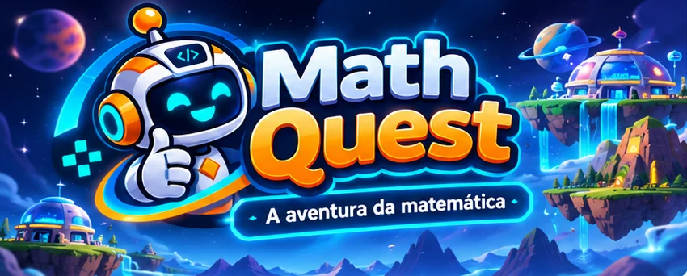

<!-- Math Quest — README principal -->

  

<h1 align="center">Math Quest</h1>

<strong>Aprender matemática. Resolver desafios. Criar possibilidades.</strong>

  
  
  
  
  

  <a href="https://viniciusandradde.github.io/math-quest/"><strong>Abrir aplicativo</strong></a> ·
  <a href="#metodologia-de-aprendizagem">Metodologia</a> ·
  <a href="#alinhamento-com-a-bncc">BNCC</a> ·
  <a href="docs/AGE-PROFILES.md">Perfis por idade</a> ·
  <a href="docs/PEDAGOGY.md">Pedagogia</a> ·
  <a href="docs/ASSESSMENT.md">Diagnóstico</a> ·
  <a href="docs/ARCHITECTURE.md">Arquitetura</a> ·
  <a href="docs/PRIVACY.md">Privacidade</a> ·
  <a href="LICENSE">Licença</a>

---

## Sumário

1. [Sobre o Math Quest](#sobre-o-math-quest)
2. [Perfis por idade](#perfis-por-idade)
3. [Metodologia de aprendizagem](#metodologia-de-aprendizagem)
4. [Alinhamento com a BNCC](#alinhamento-com-a-bncc)
5. [Avaliação, evidências e recompensas](#avaliação-evidências-e-recompensas)
6. [Acessibilidade e inclusão](#acessibilidade-e-inclusão)
7. [Identidade visual](#identidade-visual)
8. [Privacidade e proteção de crianças](#privacidade-e-proteção-de-crianças)
9. [Tecnologia](#tecnologia)
10. [Executar, testar e publicar](#executar-testar-e-publicar)
11. [Estrutura e documentação](#estrutura-do-repositório)
12. [Roadmap](#roadmap) · [Governança](#governança-do-projeto) · [Licença](#licença-e-propriedade-intelectual)

## Sobre o Math Quest

**Math Quest é uma plataforma de aprendizagem matemática baseada em jogos, desafios e progressão individual**, com experiência mobile-first e instalável como aplicativo (PWA). Funciona sem cadastro e guarda o progresso só no aparelho.

O app tem duas experiências, escolhidas pela faixa de idade na primeira abertura:

- **Pequeno Explorador (3 a 6 anos):** brincadeiras de quantidade, formas e sequências, com um professor de voz que explica tudo devagar.
- **Explorador Estratégico (11 a 13 anos):** missões em várias etapas com frações, decimais, porcentagem, geometria e lógica, além de memória matemática, laboratório visual e diagnóstico.

Não é apenas um quiz. O objetivo é que a criança:
- compreenda o significado das ideias matemáticas antes de ser cobrada por velocidade;
- represente quantidades com objetos, desenhos, matrizes e símbolos;
- identifique padrões e relações;
- desenvolva fluência por recuperação ativa e mantenha o que aprendeu com revisões;
- aplique a matemática em problemas contextualizados e explique a estratégia;
- ganhe confiança para enfrentar novos desafios.

> **Princípio do produto:** compreensão antes da velocidade. Errar é parte do caminho: o app explica, nunca pune.

## Perfis por idade

Na primeira abertura, um adulto escolhe quem vai jogar. **Só a faixa de idade fica salva no aparelho** (nunca nome ou data de nascimento). A troca fica na área de Progresso/Adultos, com confirmação em dois toques, e cada perfil mantém o próprio progresso.

| | Pequeno Explorador | Explorador Estratégico |
|---|---|---|
| **Faixa** | 3 a 6 anos | 11 a 13 anos |
| **Atividades** | 10 brincadeiras: Ache o igual, Qual é diferente?, Grande e pequeno, Conte comigo, Onde tem mais?, Formas, O que vem depois?, Antes e depois, Juntar, Tirar | Mapa com 6 missões estratégicas, memória matemática, laboratório visual, aquecimento, diagnóstico |
| **Apoio** | Professor de voz calmo, legenda, pontinhos sob os números | Explicação da estratégia, pista de resolução, materiais para imprimir |
| **Dificuldade** | 7 níveis por brincadeira: 2 opções e números até 3 no nível 1; o nível sobe com acertos de primeira | Problemas em várias etapas; mapa e coleção mostram o avanço |
| **Recompensas** | Estrelas por acerto de primeira | XP, nível de explorador e 10 itens colecionáveis |

Detalhes em [docs/AGE-PROFILES.md](docs/AGE-PROFILES.md).

## Metodologia de aprendizagem

O Math Quest adota uma abordagem própria, a **Jornada de Domínio Matemático**, fundamentada em práticas educacionais reconhecidas e adaptada para uma experiência digital.

### Referências

| Referência | O que aproveitamos | Onde aparece |
|---|---|---|
| Montessori | Material concreto, uma ideia por vez, controle do erro pela própria atividade | Contar tocando, Ache o igual, laboratório de matrizes |
| Singapura (CPA) | Concreto → pictórico → abstrato, com volta às representações anteriores | Objetos → pontinhos → numeral; grupos → matriz → multiplicação |
| Correspondência termo a termo e cardinalidade | Cada objeto recebe um número; o último número dito indica a quantidade | Conte comigo e Juntar |
| Aprendizagem sem erro (errorless learning) | Poucas opções, dica imediata e nova tentativa até acertar | Todas as brincadeiras de 3 a 6 anos |
| Kumon | Passos pequenos e progressão guiada pelo desempenho | Níveis adaptativos |
| Olimpíada Kanguru | Problemas contextualizados, interpretação e raciocínio | Missões estratégicas |
| Recuperação ativa (retrieval practice) | Responder sem consultar a solução; feedback depois da tentativa | Missões, memória, aquecimento |
| Prática espaçada | Revisitar conteúdos em intervalos | Planejada (roadmap 0.5) |
| Aprendizagem baseada em jogos | Objetivos claros, feedback, exploração e recompensas ligadas à aprendizagem | Mapa de missões, coleção, estrelas |

Essas referências são inspirações pedagógicas, não afiliações. O Math Quest não é produto oficial, parceiro ou representante da Olimpíada Kanguru, do método Kumon, de Montessori, de Singapura ou do Scratch.

### Ciclo pedagógico

1. **Descobrir:** compreender a ideia com situações concretas.
2. **Visualizar:** representar quantidades com objetos, grupos, desenhos e matrizes.
3. **Explorar:** descobrir padrões e propriedades.
4. **Praticar:** resolver com apoio progressivamente reduzido.
5. **Recuperar:** responder sem consultar a solução.
6. **Aplicar:** resolver problemas novos e explicar a estratégia.
7. **Revisar:** retomar conteúdos em intervalos adaptados ao desempenho.

### 3 a 6 anos — Pequeno Explorador

Pensado para a criança que está saindo da fase de bebê:

- **Concreto e manipulável:** a criança toca em cada objeto para contar; o numeral vem depois.
- **Uma ideia por vez:** cada brincadeira trabalha uma única habilidade.
- **Poucas escolhas:** no nível 1 há só duas opções e quantidades até 3.
- **Sem erro que pune:** a opção que não serve apaga, o professor dá uma dica e a criança tenta de novo.
- **Rodadas curtas:** 4 perguntas, respeitando a atenção nessa idade, e sem tempo.
- **Apoio para quem ainda não lê:** voz, legenda, pontinhos sob os números e figuras grandes.

| Brincadeira | Habilidade | Do nível 1 ao nível 7 | A partir de |
|---|---|---|---|
| Ache o igual | Discriminar e classificar por forma, cor e tamanho | 2 opções bem diferentes → 4 opções que diferem em um só atributo, incluindo tamanho | 3 anos |
| Qual é diferente? | Achar a figura que não combina | 3 figuras (forma e cor diferentes) → 5 figuras em que só a cor, a forma ou o tamanho muda | 3 anos |
| Grande e pequeno | Comparar tamanhos | 2 objetos (maior) → 4 objetos com diferenças sutis → "o do meio" | 3 anos |
| Conte comigo | Contar tocando um a um e relacionar ao numeral | Até 3 → 5 → 6 → 8 → 10 → 12 → 15 | 3 anos |
| Onde tem mais? | Comparar quantidades | 2 grupos com diferença grande → 3 grupos até 12, com "mais" e "menos" | 3 anos |
| Formas | Reconhecer formas | Círculo, quadrado e triângulo → retângulo, oval, losango e estrela | 3 anos |
| O que vem depois? | Reconhecer e continuar padrões | AB → AAB → ABC → AABB → figura faltando no meio da fila | 4 anos |
| Antes e depois | Vizinhos dos números | "Depois" até 5 → "antes" → "entre" → até 20 | 4 anos |
| Juntar | Adição com objetos | Soma até 4 → até 10 | 5 anos |
| Tirar | Subtração com objetos ("quantos ficaram?") | Tirar 1 de até 3 → tirar vários de até 10 | 5 anos |

**Níveis adaptativos:** cada brincadeira tem 7 níveis, e o nível sobe sozinho com evidência (acertos de primeira acumulados e proporção de acertos de primeira):

| Nível | 2 | 3 | 4 | 5 | 6 | 7 |
|---|---|---|---|---|---|---|
| Acertos de primeira | 4 | 8 | 12 | 16 | 20 | 25 |
| Proporção mínima | 60% | 65% | 65% | 70% | 70% | 75% |

O nível 1 atende a criança de 3 anos; o nível 7, a que está perto dos 6 e da entrada no 1º ano. As regras de cada nível ficam em tabelas no código (`src/learning/early.ts`), fáceis de revisar com um educador.

### Professor de voz

Nas brincadeiras de 3 a 6 anos, o mascote é um professor que **explica com voz tranquila, devagar e calma**:

- ao abrir, explica como brincar em frases curtas, uma de cada vez, com pausas;
- em cada pergunta, fala só o pedido ("Quantas estrelas tem aqui?");
- depois de uma tentativa que não deu certo, dá uma dica passo a passo; ao contar, cada objeto acende junto com o número falado;
- comemora o acerto explicando o porquê ("São três estrelas.");
- a frase falada aparece escrita no balão (legenda), e o botão **Ouvir de novo** repete a explicação;
- velocidade "Bem devagar" (padrão) ou "Normal", ajustável na área dos adultos.

A voz usa a síntese de fala do próprio aparelho (Web Speech API, português do Brasil), sem enviar nada a servidores. Como as frases são fixas, elas podem ser substituídas por gravações de voz profissional sem mudar o app.

### 11 a 13 anos — Explorador Estratégico

- **Mapa de Missões:** 6 problemas em várias etapas (operações combinadas, frações de quantidades, decimais e dinheiro, área e perímetro, sequências e frações com operações). Cada resposta recebe explicação da estratégia e pista de resolução.
- **Memória matemática:** associa operações (3/4 de 40, 25% de 80, 1,5 + 2,75, área e perímetro) aos resultados, sem cronômetro; o feedback explica o cálculo e aponta erros de unidade de medida sem revelar a resposta.
- **Laboratório visual:** multiplicação como grupos iguais e matrizes (CPA), com comutatividade.
- **Aquecimento:** fatos de multiplicação contextualizados (energia dos robôs).
- **Diagnóstico:** 6 perguntas de baixo risco que mapeiam habilidades por nível, sem nota.
- **Materiais físicos:** Caderno de Missões e folhas para imprimir, com gabarito para o educador ([docs/PRINTABLES.md](docs/PRINTABLES.md)).

> O banco atual de missões está no nível do 5º ano, com extensão ao 6º e 7º anos. Para alunos de 12 e 13 anos, o próximo passo é ampliar o banco com missões mais desafiadoras.

## Alinhamento com a BNCC

O conteúdo foi desenhado tendo como referência a **Base Nacional Comum Curricular (BNCC)**. As tabelas abaixo indicam os campos de experiência, objetivos e habilidades relacionados a cada atividade.

> **Importante:** este é um alinhamento de referência, descrito com nossas palavras. Antes de usar em planejamento escolar ou material oficial, valide os códigos e textos no [documento oficial da BNCC](http://basenacionalcomum.mec.gov.br/) com um educador.

### Educação Infantil — 3 a 6 anos

Na Educação Infantil, a BNCC organiza a aprendizagem em **direitos de aprendizagem** (conviver, brincar, participar, explorar, expressar e conhecer-se) e **campos de experiência**. As brincadeiras trabalham principalmente o campo **"Espaços, tempos, quantidades, relações e transformações"**, nos grupos de *crianças bem pequenas* (EI02, até 3 anos e 11 meses) e *crianças pequenas* (EI03, 4 a 5 anos e 11 meses). Também exercitam a escuta e a compreensão de instruções orais (campo "Escuta, fala, pensamento e imaginação"), por meio do professor de voz.

| Brincadeira | Objetivos de aprendizagem | Como a brincadeira trabalha |
|---|---|---|
| Ache o igual | **EI02ET05**: classificar objetos por um atributo (tamanho, peso, cor, forma). **EI03ET05**: classificar objetos e figuras por semelhanças e diferenças | Encontrar a figura com a mesma forma, cor e tamanho; nos níveis altos, distinguir figuras que diferem em um só atributo |
| Qual é diferente? | **EI02ET05** e **EI03ET05** | Identificar a figura que não combina, pela forma, pela cor ou pelo tamanho |
| Grande e pequeno | **EI02ET05** (atributo tamanho) e **EI03ET05** | Comparar tamanhos: o maior, o menor e, no nível 7, o do meio |
| Formas | **EI02ET05** e **EI03ET05** | Reconhecer e nomear círculo, quadrado, triângulo e retângulo pelas características ("tem três lados e três pontas") |
| Conte comigo | **EI02ET07**: contar oralmente objetos em contextos diversos. **EI03ET07**: relacionar números às quantidades | Tocar em cada objeto enquanto o professor conta; escolher o numeral (com pontinhos de apoio no nível 1) |
| Onde tem mais? | **EI03ET07** | Comparar a quantidade de dois grupos; no nível 3, identificar também onde tem menos |
| O que vem depois? | **EI03ET07**: identificar o antes, o depois e o entre em uma sequência | Continuar padrões de figuras (AB, AAB, ABC, AABB) e completar a figura que falta, preparando a ideia de regularidade |
| Antes e depois | **EI03ET07**: relacionar números às quantidades e identificar o antes, o depois e o entre | Descobrir o número que vem antes, depois ou entre outros numa fila de números (até 20) |
| Juntar | **EI03ET07** | Juntar dois grupos e contar o total, preparando a adição com o significado de juntar do 1º ano |
| Tirar | **EI03ET07** | Ver alguns objetos "irem embora" e contar os que ficaram, preparando a subtração com o significado de retirar do 1º ano |

### Ensino Fundamental — Matemática, 11 a 13 anos

As atividades se relacionam às **unidades temáticas** Números, Álgebra, Geometria e Grandezas e medidas, e às competências de resolver e elaborar problemas, raciocinar logicamente e justificar estratégias.

| Atividade | Unidade temática | Habilidades | Como a atividade trabalha |
|---|---|---|---|
| Missão 1 — Estoque de energia | Números | **EF05MA07**, **EF05MA08**: problemas com adição, subtração, multiplicação e divisão | Problema em várias etapas (6 × 8, subtrações sucessivas) |
| Missão 2 — Peças da nave | Números | **EF05MA03**: frações como parte de um todo | Calcular frações de uma quantidade e somar os resultados |
| Missão 3 — Compra no centro de comando | Números | **EF05MA07**, **EF05MA08**: problemas com números racionais na forma decimal | Compra, soma de custos e troco em reais |
| Missão 4 — Plataforma de pouso | Grandezas e medidas / Geometria | **EF05MA20**: área e perímetro de figuras; **EF06MA24**: problemas com área de retângulos | Calcular a área e diferenciá-la do perímetro |
| Missão 5 — Sequência do código | Álgebra | **EF07MA14**: classificar sequências recursivas | Descobrir a regra (× 2 + 1) e o próximo termo |
| Missão 6 — Distribuição de suprimentos | Números | **EF05MA03**, **EF05MA07** | Frações de quantidades diferentes e soma |
| Memória matemática | Números / Grandezas e medidas | **EF05MA06** e **EF06MA13**: porcentagens; **EF05MA03**; **EF05MA07**; **EF05MA20** | Associar 25% de 80, 3/4 de 40, decimais, área e perímetro aos resultados |
| Laboratório visual, aquecimento e diagnóstico | Números (retomada) | **EF03MA07** e **EF04MA06**: significados da multiplicação (parcelas iguais, organização retangular) | Retomar fundamentos da multiplicação quando o diagnóstico indicar necessidade |

## Avaliação, evidências e recompensas

- **Diagnóstico por habilidade, não por nota:** o resultado orienta a próxima atividade ("Em desenvolvimento", "Vamos praticar juntos"), sem rótulos negativos ([docs/ASSESSMENT.md](docs/ASSESSMENT.md)).
- **Acerto de primeira como evidência:** nas brincadeiras de 3 a 6 anos, a criança tenta até acertar, mas só o acerto de primeira conta para estrelas e níveis.
- **"Resolvido" não é "dominado":** a área de progresso deixa claro que um acerto é uma amostra; a retenção será observada em revisões futuras.
- **Dimensões de domínio:** compreensão, precisão, fluência, retenção e transferência. Velocidade isolada nunca é prova de domínio.
- **Recompensas ligadas à aprendizagem:** XP vem de acertos e conclusões; cada um dos 10 itens do brand board é ganho com uma evidência (primeiro acerto, missões resolvidas, partidas da memória, diagnóstico). **Errar nunca tira pontos.**
- **Sem comparação:** não há rankings, sequências diárias obrigatórias nem pressão por tempo de tela.
- **Papel do adulto:** a área de Progresso/Adultos mostra o resumo por atividade e permite ajustar a voz e trocar o perfil.

## Acessibilidade e inclusão

- Alvos de toque grandes e layout testado a partir de 360 px de largura.
- Professor de voz com legenda escrita e botão para repetir.
- Forma e cor mudam juntas nas sequências e no "Ache o igual", o que ajuda crianças daltônicas.
- Números e contas em fonte legível (Inter); títulos em Orbitron.
- Animações respeitam a opção "reduzir movimento" do sistema; o som e a voz podem ser silenciados.
- Botões com nomes acessíveis, região de leitura para feedback e navegação por teclado com foco visível.

## Identidade visual

O universo combina robótica, exploração, laboratório e tecnologia. O mascote robô acompanha a jornada como guia, sem infantilizar os mais velhos. A identidade segue o [brand board](assets/brand/reference/math-quest-brand-board.png):

| Papel | Cor |
|---|---|
| Primária | `#0B1B3B` |
| Secundária | `#0D6EFD` |
| Destaque | `#00E5FF` |
| Ação | `#FF8A00` |
| Apoio | `#FFCB57` |
| Acerto | `#21C02B` |

- **Tipografia:** Orbitron (títulos) e Inter (textos e números), empacotadas para uso offline.
- **Kit em uso no app:** arte principal, 10 expressões e 4 poses do mascote, 4 cenários, 10 itens e Caderno de Missões ([public/assets/kit](public/assets/kit/), [catálogo](public/assets/ASSET-CATALOG.md), [docs/BRAND.md](docs/BRAND.md)).
- **Assinatura:** Aprender matemática. Resolver desafios. Criar possibilidades.

## Privacidade e proteção de crianças

O produto é destinado a crianças e pré-adolescentes; privacidade e segurança são requisitos desde o início.
- Sem cadastro: pergunta só a **faixa de idade**, guardada no aparelho.
- Todo o progresso fica no IndexedDB do aparelho; nada é enviado a servidores.
- O professor de voz usa a síntese do próprio aparelho.
- Respostas digitadas guardam só o valor numérico, nunca texto livre.
- Sem publicidade, rankings públicos, localização, contatos, câmera ou microfone.
- Antes de qualquer operação com contas ou nuvem: avaliar a LGPD (melhor interesse e consentimento aplicáveis a crianças e adolescentes) e publicar política de privacidade, retenção e exclusão.

Consulte [docs/PRIVACY.md](docs/PRIVACY.md).

## Tecnologia

| Camada | Tecnologia | Responsabilidade |
|---|---|---|
| Frontend | React 19 + TypeScript | Interface e componentes |
| Build | Vite | Desenvolvimento e compilação |
| Estilos | Tailwind CSS 4 | Tokens da marca, layout responsivo e animações |
| Tipografia | Orbitron + Inter (@fontsource) | Fontes empacotadas para uso offline |
| Voz | Web Speech API (pt-BR) | Professor de voz para 3 a 6 anos |
| Sons | Web Audio API | Efeitos sonoros sintetizados (acerto, tente de novo, recompensa) |
| Persistência local | Dexie + IndexedDB (schema v4) | Perfil de idade e progresso de cada perfil no aparelho |
| PWA | vite-plugin-pwa | Instalação, uso offline e aviso de atualização |
| Testes | Vitest + Testing Library + fake-indexeddb | Regras pedagógicas, telas, voz e banco local |
| CI/CD | GitHub Actions | Typecheck, testes, build, verificação do PWA e publicação |
| Hospedagem | GitHub Pages | Distribuição estática em `/math-quest/` |

Regras pedagógicas ficam em `src/learning` (puras e testáveis, sem interface). O `App` lê a faixa de idade e abre o `EarlyApp` (3 a 6) ou o `ExplorerApp` (11 a 13).

**Evolução da plataforma:** o MVP é estático para reduzir custo e acelerar a validação. Para contas e sincronização, a evolução prevista inclui API em FastAPI, PostgreSQL, OAuth2/OIDC com RBAC (responsável/estudante), armazenamento de mídia em S3/MinIO e deploy em containers, com decisões registradas em ADRs ([docs/ARCHITECTURE.md](docs/ARCHITECTURE.md)). Nenhum segredo vai no frontend.

## Executar, testar e publicar

Requisitos: Node.js 22.12 ou superior e npm 10 ou superior.

~~~bash
git clone https://github.com/viniciusandradde/math-quest.git
cd math-quest
npm install
npm run dev        # desenvolvimento (http://localhost:5173/math-quest/)
npm run typecheck  # verificação TypeScript
npm run test       # testes automatizados
npm run build      # build de produção
npm run verify:pwa # confere manifest, service worker e arquivos essenciais
npm run preview    # visualizar o build local
~~~

**Publicação:** o workflow [.github/workflows/deploy.yml](.github/workflows/deploy.yml) roda typecheck, testes, build e verificação do PWA em cada pull request e publica no GitHub Pages a cada push na `main` (Settings → Pages → Source: GitHub Actions). Endereço: **https://viniciusandradde.github.io/math-quest/**. Com o repositório privado, o GitHub Pages exige plano pago.

**PWA beta 0.1.0-beta.1:** instalação, uso offline e atualização ainda precisam do teste real em Android previsto no [checklist de aceite](docs/PWA-BETA-ACCEPTANCE.md).

## Estrutura do repositório

~~~text
math-quest/
├── .github/workflows/      # CI e publicação no GitHub Pages
├── assets/brand/           # logo e referências do brand board (não publicadas)
├── docs/                   # produto, pedagogia, perfis, BNCC, arquitetura e privacidade
├── public/
│   ├── assets/kit/         # elementos do brand board usados no app
│   ├── assets/printables/  # materiais para imprimir
│   └── icons/              # ícones do PWA
├── scripts/                # verificação do PWA e extração do kit visual
└── src/
    ├── app/                # porta de entrada por perfil, EarlyApp e ExplorerApp
    ├── components/         # mascote, professor de voz, itens, confete, ícones
    ├── features/
    │   ├── profile/        # escolha da faixa de idade
    │   ├── early/          # brincadeiras de 3 a 6 anos
    │   ├── home/           # tela inicial e mapa de missões (11 a 13)
    │   ├── challenges/     # missões estratégicas
    │   ├── memory/         # memória matemática
    │   ├── learn/, lab/    # laboratório visual
    │   ├── practice/       # aquecimento
    │   ├── diagnostic/     # diagnóstico
    │   └── parent/         # progresso e área dos adultos
    ├── learning/           # regras pedagógicas puras e testáveis
    ├── lib/                # banco local, voz e sons
    └── styles/             # tokens da marca e animações
~~~

### Documentação

| Documento | Conteúdo |
|---|---|
| [docs/AGE-PROFILES.md](docs/AGE-PROFILES.md) | Perfis por idade, brincadeiras, níveis e professor de voz |
| [docs/PEDAGOGY.md](docs/PEDAGOGY.md) | Fundamentação pedagógica e dimensões de domínio |
| [docs/ASSESSMENT.md](docs/ASSESSMENT.md) | Diagnóstico e regras de interpretação |
| [docs/PRINTABLES.md](docs/PRINTABLES.md) · [gabarito](docs/CHALLENGE-ANSWER-KEY.md) | Materiais físicos e respostas para o educador |
| [docs/PRODUCT.md](docs/PRODUCT.md) | Visão, público e requisitos |
| [docs/BRAND.md](docs/BRAND.md) | Identidade visual, mascote e recompensas |
| [docs/ARCHITECTURE.md](docs/ARCHITECTURE.md) · [ADRs](docs/DECISIONS/) | Arquitetura e decisões |
| [docs/PRIVACY.md](docs/PRIVACY.md) | Privacidade e proteção de crianças |
| [docs/WELLBEING-ANALYSIS.md](docs/WELLBEING-ANALYSIS.md) | Análise da Missão de Brincar (Tumba da Máscara) e proposta de área dos pais |
| [docs/standards/CHILD-WELLBEING-STANDARD.md](docs/standards/CHILD-WELLBEING-STANDARD.md) | Padrão VSA de bem-estar digital infantil para todas as aplicações |
| [docs/PWA-BETA-ACCEPTANCE.md](docs/PWA-BETA-ACCEPTANCE.md) | Aceite técnico do PWA |
| [docs/SCRATCH-LAB.md](docs/SCRATCH-LAB.md) | Ponte futura para programação em blocos |

## Roadmap

- [x] Produto, público e direcionamento pedagógico.
- [x] Arquitetura estática compatível com GitHub Pages e PWA.
- [x] Diagnóstico inicial por habilidade.
- [x] Laboratório visual com matrizes interativas.
- [x] Missões estratégicas, mapa de missões e memória matemática.
- [x] Registro local das tentativas e resumo para responsáveis.
- [x] Identidade visual do brand board, XP, nível e coleção de itens.
- [x] Perfis por idade: 3 a 6 anos (com professor de voz) e 11 a 13 anos.
- [ ] Vozes gravadas com voz profissional para o professor de voz.
- [ ] Missões mais desafiadoras para 12 e 13 anos e perfil de 7 a 10 anos.
- [ ] Tabuadas adaptativas e revisão espaçada com avaliação de retenção.
- [ ] Exportar e importar progresso.
- [ ] Demais jogos (circuito, fábrica de robôs, escape).
- [ ] Scratch Lab.
- [ ] Validação da BNCC e das atividades por educador; piloto supervisionado com crianças.

Detalhes em [docs/ROADMAP.md](docs/ROADMAP.md).

## Governança do projeto

**Investigar → Projetar → Fundamentar → Construir → Testar → Validar → Evoluir.**

Toda funcionalidade pedagógica deve ter objetivo de aprendizagem, habilidade (com referência à BNCC quando aplicável), instrução e feedback, critérios de sucesso, testes automatizados e evidência de aprendizagem esperada. Consulte [CONTRIBUTING.md](CONTRIBUTING.md).

## Licença e propriedade intelectual

**Math Quest é um projeto proprietário da VSA Tecnologia.** O código-fonte, identidade visual, textos, conteúdos pedagógicos, personagens, mecânicas originais e materiais próprios são protegidos por direitos autorais.

A licença deste repositório é proprietária e não concede autorização para copiar, modificar, redistribuir, sublicenciar ou explorar comercialmente o software sem autorização escrita da VSA Tecnologia.

Bibliotecas e componentes de terceiros permanecem sujeitos às respectivas licenças. Consulte [LICENSE](LICENSE) e os avisos de terceiros antes de distribuir uma versão do produto.

A publicação de um repositório no GitHub não significa que seu conteúdo esteja em domínio público. A licença proprietária também não substitui a revisão jurídica necessária para comercialização.

---

   
  <strong>Math Quest</strong> 
  Um produto educacional da <strong>VSA Tecnologia</strong>. 
  Aprender matemática. Resolver desafios. Criar possibilidades.

